<p align="center">
  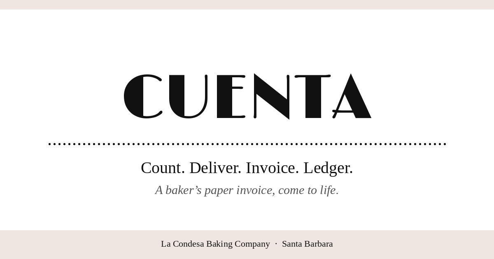
</p>

# Cuenta

**Count, deliver, invoice, ledger for a wholesale bakery.** Built for La Condesa Baking Company in Santa Barbara.

The app is private and sits behind a PIN, so the demo video below walks through the whole thing.

## Demo video

[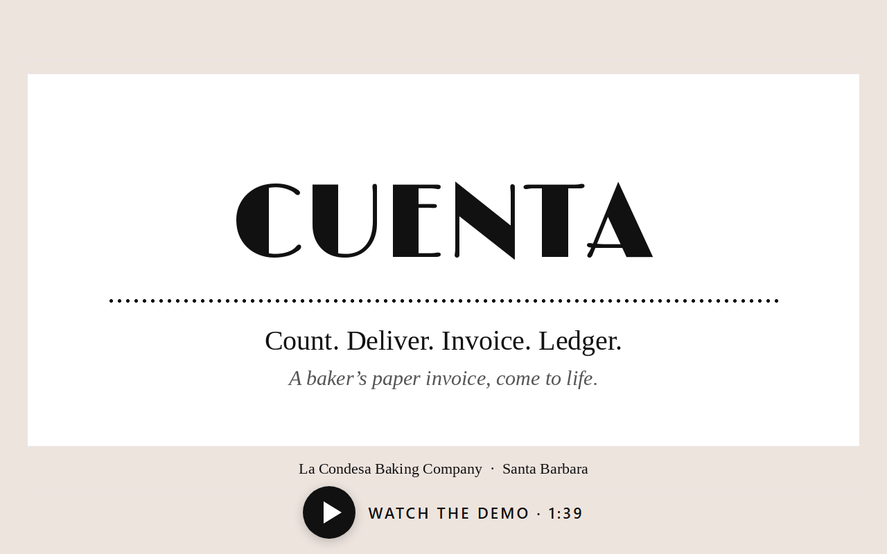](https://youtu.be/jktG-dGdQZc)

One minute and thirty-nine seconds on the production app, with mock data: Count, Deliver, the invoice, Download PDF, Send email, the Ledger and the menu.

Built from an empty folder to a working app in about 20 hours, sleep included, using the Devpost Learn skill pack.

## The problem

Eileen runs a wholesale bakery that serves four cafes. She counted what was left on each cafe's shelf on paper. She filled in her invoice forms by hand and did the math by hand. And she kept track of who owed her, and since when, in her head.

## Why Cuenta solves it

Cuenta puts the whole route in one phone-first flow: **count the shelf, build the delivery, send the invoice, and see who owes what.**

- **Her brand on every invoice.** The invoice is her own Canva form, drawn exactly, for print, PDF and email.
- **One menu.** The same products and prices for every cafe, so a delivery starts from the menu, not a blank page.
- **No math by hand.** Line totals and invoice totals are worked out in whole cents as she types.
- **Nothing to remember.** The Ledger shows what's open, outstanding, paid and overdue.

The full judge path (Count, Deliver, Invoice with Print and Email, Ledger) runs end to end on production in **15.9 seconds**.

## Features at a glance

| Screen | What it does |
|---|---|
| **PIN** | Six-digit PIN, remembered on the device for 30 days |
| **Count** | Pick the cafe, enter what's on the shelf, save. The last count shows in grey. **Past counts** lists earlier days, newest first |
| **Deliver** | Pick the cafe and the menu appears with prices and the latest shelf count. Type quantities and totals update live. The invoice number is suggested (location code plus date). **+ Add special order** for one-off items |
| **Invoice** | Her Canva form, filled in. **Print**, **Download PDF**, **Send email** (shows "Sending…", then "Last sent"), **Edit**, **Void** |
| **Ledger** | Open, Outstanding and This month. Filter by cafe. Mark paid or unpaid. Overdue rows stand out. Void rows are crossed out |
| **Customers** | The menu once at the top, then each cafe's details, read-only |
| **How it works** | A "?" on every page opens a plain-words guide to each button |

<p align="center">
  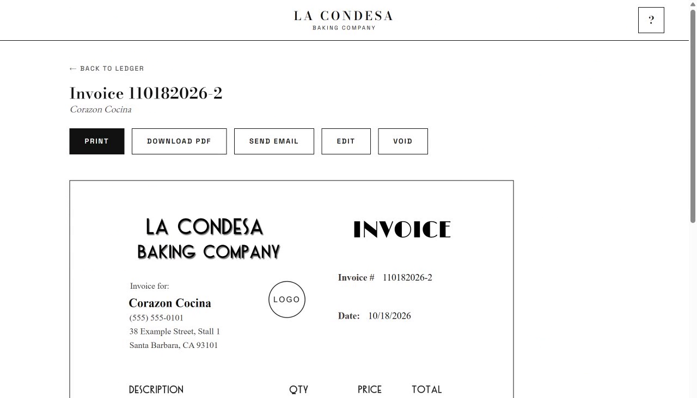<br>
  <b>Invoice</b>
</p>

<table>
  <tr>
    <td width="50%">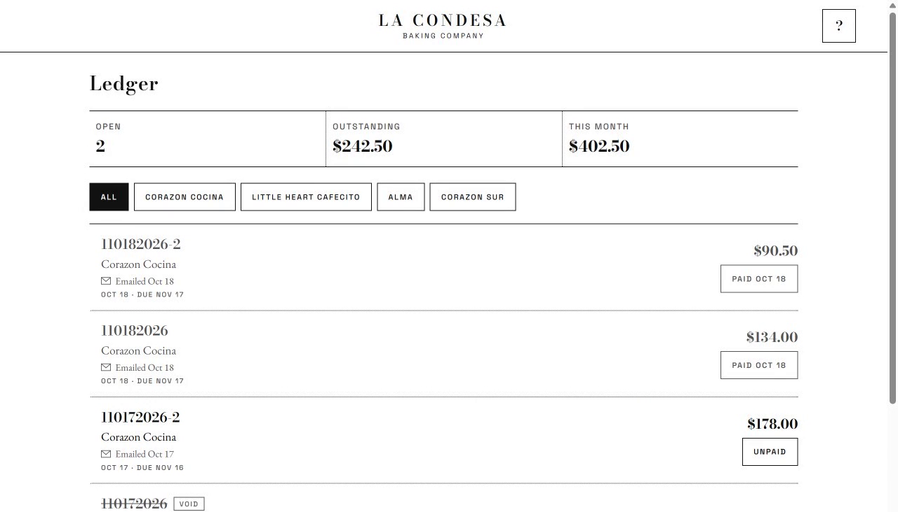</td>
    <td width="50%">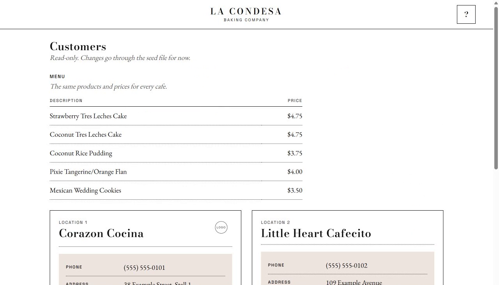</td>
  </tr>
  <tr>
    <td align="center"><b>Ledger</b></td>
    <td align="center"><b>Customers</b></td>
  </tr>
</table>

## Architecture

One Next.js app on Vercel, with Neon Postgres for data, Resend for email and headless Chromium for the PDF.

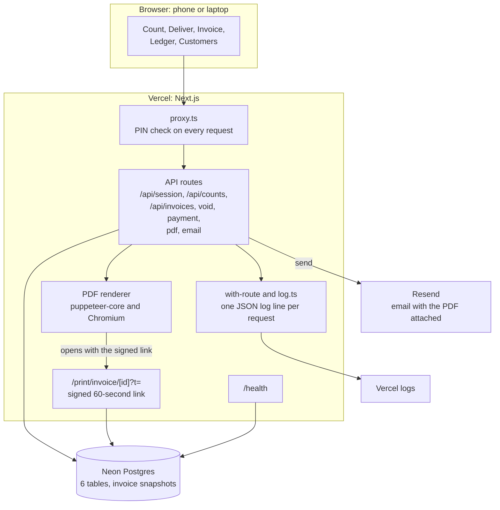

- The print route skips the PIN check but only opens with a valid signed link for that one invoice, which expires in 60 seconds. Only the PDF and email routes can make one, after the PIN check.
- Eileen's **Print** button prints the Invoice screen directly, with print styles, so the printout, the PDF and the email attachment all come from the same invoice component.

## How it was built

Cuenta was built with Claude Code and the **Devpost Learn** skill pack, plan first:

1. **Planning documents before any code:** [scope](devpost/scope.md), [PRD](devpost/prd.md) and [technical spec](devpost/spec.md).
2. **Eight slices,** each a small working step that could be tried end to end. Each had a mechanical check (a test, a command, or an observed result) and a hands-on checkpoint before the next one began. The plan, every checkpoint and every change to the plan are in the [build checklist](devpost/checklist.md).
3. **A final review and an app map:** [app-map.html](devpost/app-map.html) follows one action through the code and says where to start a change.

## Visuals

Screenshots from the planning pages. Each one links to the full page.

| | |
|---|---|
| [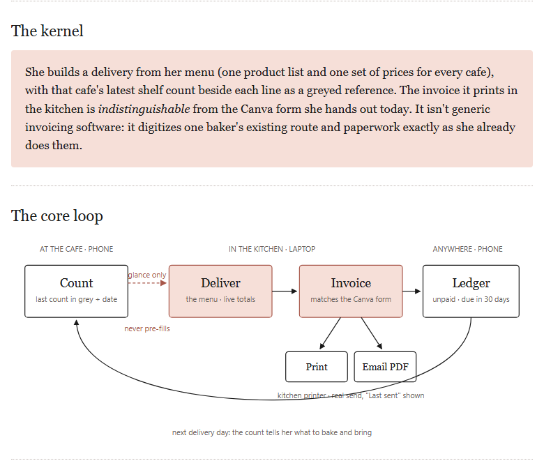](https://earlgreyhot1701d.github.io/cuenta/scope.html)<br/>**Scope:** the kernel and the core loop | [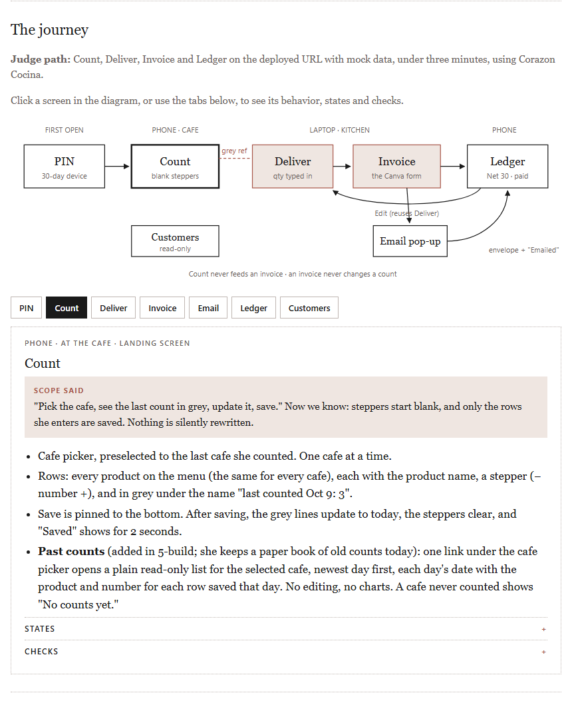](https://earlgreyhot1701d.github.io/cuenta/prd.html)<br/>**PRD:** the journey, screen by screen |
| [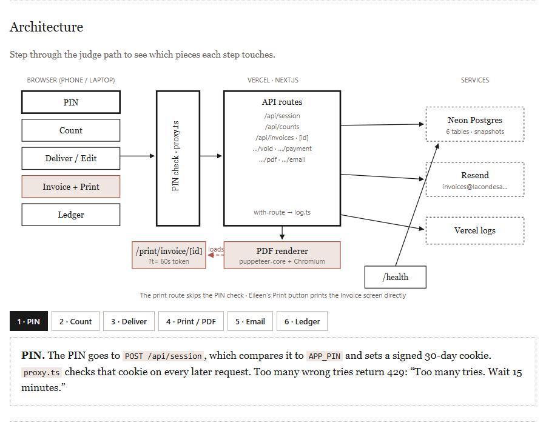](https://earlgreyhot1701d.github.io/cuenta/spec.html)<br/>**Spec:** the architecture, step by step | [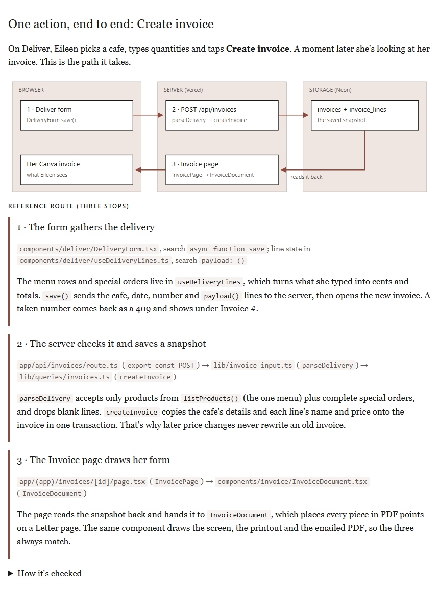](https://earlgreyhot1701d.github.io/cuenta/app-map.html)<br/>**App map:** Create invoice, end to end |

[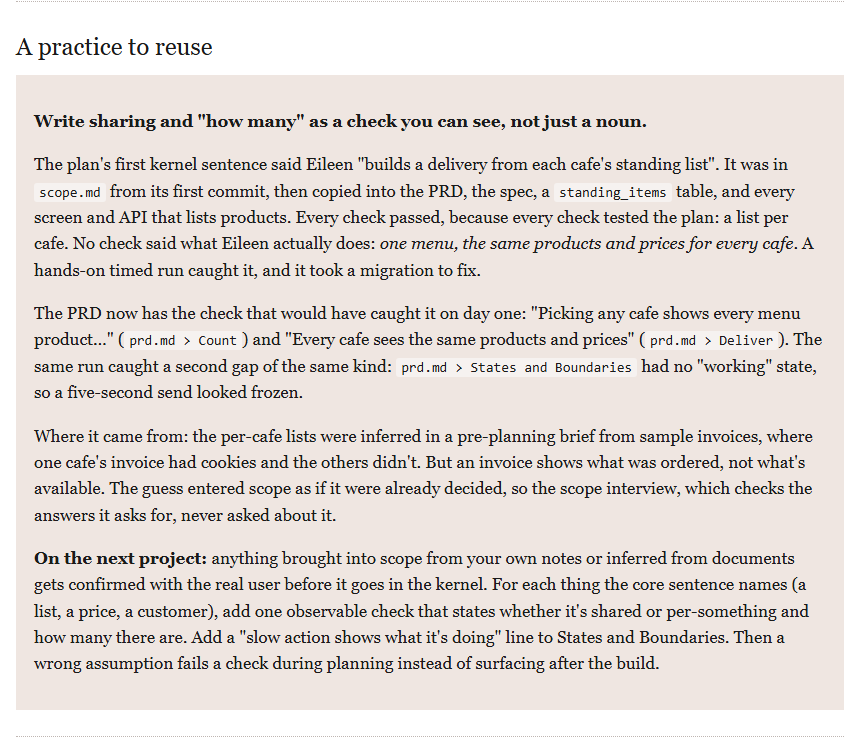](https://earlgreyhot1701d.github.io/cuenta/app-map.html)

## Data model

Six tables in Neon Postgres, defined with Drizzle. Money is stored in whole cents.

- **Invoices are snapshots.** Each line keeps its own name, price and quantity, and the cafe's details are copied onto the invoice. A later price change never rewrites an old invoice.
- **One menu.** Every active product, in menu order, is on every cafe's Count and Deliver, at one price.
- **Counts are per cafe** and are only ever added, never edited, so the history stays intact.
- **Nothing is deleted in the app.** A wrong invoice is voided: it stays visible, crossed out, and its number stays taken.

## Security

- **Six-digit PIN with lockout:** 5 wrong tries from one IP, or 20 overall, within 15 minutes lock the PIN for 15 minutes. The check takes the same time for any guess.
- **Signed session cookie:** httpOnly, SameSite=Lax, Secure in production, valid for 30 days.
- **Not indexed:** an `X-Robots-Tag: noindex, nofollow` header on every response, plus a `robots.txt` that disallows everything.
- **Signed 60-second print links,** scoped to one invoice. A bad or expired link returns 404.
- **Secrets stay on the server:** they live only in server environment variables, and logs never contain the PIN, email addresses, phone numbers or invoice contents.
- **Reporting a problem:** see [`security.txt`](public/.well-known/security.txt).

## Testing

- **42 unit tests** in 9 files (Vitest): dates, money, invoice numbers, the one-page line limit, delivery validation (including special orders), Ledger stats, email status, print links and sessions.
- **The judge path** (Playwright): Count, Deliver, Invoice with Print and Email, then Ledger with Mark paid, timed against a 3-minute limit. It voids its own test invoice at the end.
- **A mock-data audit** checks every tracked file for real names, addresses, phone numbers and emails.

```bash
npm test                                    # unit tests
npm run test:e2e                            # judge path against http://localhost:3000
E2E_BASE_URL=https://your-deploy.example \
E2E_MANUAL_PIN=1 npx playwright test --headed   # type the PIN in the window yourself
# add E2E_SEND=1 to really send the email
node scripts/audit-mock-data.mjs            # mock-data audit
```

## Run locally

You need Node.js, a Neon (or other Postgres) database, and a Resend API key for email.

```bash
cp .env.example .env.local    # then fill in the values
npm install
npm run db:migrate
npm run db:seed               # mock data only: this wipes the database it points at
npm run dev                   # http://localhost:3000
```

`.env.example` lists every variable. The business details on the invoice footer come from `BUSINESS_*` variables and ship as placeholders.

## What we learned

The costliest mistake came from the plan itself. The first scope said each cafe had its own product list, a guess drawn from sample invoices, which show what was ordered, not what's available. It went through the PRD, the spec and eight slices, and every check passed, because every check tested the plan. A hands-on timed run caught it: Eileen has one menu for every cafe. The rule for next time: anything brought into scope from notes or documents gets confirmed with the real user before it goes in the plan.

## Known limits and roadmap

**Known limits**
- Email now goes out from the bakery's verified domain. The switch happened on Oct 18, after the demo video was recorded.
- One PIN for one user. There are no accounts or roles.
- Products and cafes change through the seed file. Customers is read-only.

**Next**
- Eileen's real menu and cafes, and screens to edit products and cafes.
- **Export the Ledger to Excel,** filtered by cafe and dates (stubbed).
- **An accounts receivable aging report:** unpaid invoices grouped by how overdue, per cafe and in total (stubbed).
- **Overdue payment reminders:** a daily check that lists what's overdue and sends reminders in one tap after Eileen approves (stubbed).

## Version 2.0 — Production Hardening Roadmap

Cuenta's first release focuses on the essential bakery workflow: counting inventory, recording deliveries, generating invoices, and tracking payments.

Version 2.0 will focus on strengthening reliability, security, and recoverability as the application transitions into sustained daily business use.

These items are planned verification and improvement areas, not confirmed defects. Existing safeguards will be audited before additional changes are introduced.

### 1. Authentication and Authorization

- [ ] Verify that all protected routes and server actions enforce authorization.
- [ ] Review PIN rotation, session expiration, and session invalidation.
- [ ] Confirm rate limiting and lockout behavior across multiple serverless instances.
- [ ] Review whether the existing six-digit PIN authentication model remains appropriate for ongoing use.

**Acceptance criteria:** Unauthorized requests cannot access or modify protected records; lockouts and session invalidation behave consistently across deployments.

### 2. Invoice Idempotency

- [ ] Audit invoice creation and sending for duplicate submissions.
- [ ] Verify behavior when an email request times out or fails after submission.
- [ ] Add idempotency protections where needed.
- [ ] Ensure retry behavior is clearly communicated to the user.

**Acceptance criteria:** Repeated requests cannot unintentionally create duplicate invoices. Email delivery attempts are tracked, and retries cannot silently cause unexpected duplicate sends.

### 3. Database Integrity

- [ ] Review transactional boundaries for invoice and payment operations.
- [ ] Verify unique constraints and invoice-number generation under concurrent requests.
- [ ] Confirm financial records remain consistent when operations fail partway through.
- [ ] Review migration and rollback procedures.

**Acceptance criteria:** Concurrent operations preserve invoice uniqueness and financial consistency, including when requests fail or are retried.

### 4. Backup, Recovery, and Data Portability

- [ ] Document the database backup and retention strategy.
- [ ] Test restoration into a separate environment.
- [ ] Define recovery procedures for database or application outages.
- [ ] Provide an export path for critical business records.
- [ ] Document recovery responsibilities and procedures.

**Acceptance criteria:** A verified restoration procedure exists, critical records can be exported, and business data can be recovered without relying on undocumented manual intervention.

### 5. Failure-Path Testing

Expand automated testing beyond successful workflows to include:

- [ ] Database connection failures and timeouts.
- [ ] Email-provider failures and ambiguous delivery responses.
- [ ] Expired or invalid sessions.
- [ ] Duplicate requests and concurrent operations.
- [ ] Invalid monetary amounts and unexpected input.
- [ ] PDF generation failures.
- [ ] Partial failures during invoice and payment operations.

**Acceptance criteria:** Critical failure scenarios are covered by automated tests, with predictable application behavior and actionable user feedback.

### Release Philosophy

Version 2.0 is not about adding complexity for its own sake. It is about making Cuenta more dependable as Eileen incorporates it into her daily business.

New functionality will continue to be guided by real user feedback, while reliability and data protection remain engineering priorities.

**The goal is simple: the yellow book should never become a single point of failure again — digital or otherwise.**

---

<p align="center"><b>AI assisted. Human approved. Powered by NLP.</b></p>

## License

Code is MIT licensed. La Condesa Baking Company branding and cafe logos are not, and belong to their owners.
